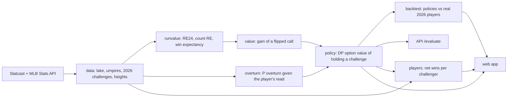

# EdgeCall

When should a batter, pitcher or catcher challenge a ball/strike call under MLB's 2026 ABS
Challenge System? EdgeCall answers that for any game situation, and estimates how many wins a
good challenge policy is worth.



## How the decision works

Challenge when `P(overturn) × gain > (1 − P(overturn)) × option value`, i.e. when
`P(overturn) > option value / (gain + option value)`.

- **Gain**: the win-probability swing of flipping the call, from count × base-out run
  expectancy and a win-expectancy table.
- **Option value**: what holding the challenge is worth for the rest of the game. It comes from a
  backward recursion over half-innings, challenges left and score, under the real rules
  (2 per team, kept on success, one granted in extras if you have none).
- **P(overturn)**: LightGBM + isotonic calibration on the player's *perceived* location, not the
  tracked one. Perception noise is fit from who actually challenged in 2026. Umpire and catcher
  tendencies come from a partial-pooling model.

## Results (fit on 2021–2025, tested on Jul–Sep 2026)

Run and win values and the overturn model are trained on 2021–2024, calibrated on 2025, and
scored on the second half of 2026 (2,296 team-games). Wins per team per 162 games, with 95%
game-bootstrap intervals:

| Policy | Wins | Runs | Challenges / game | Overturned |
|---|---|---|---|---|
| Perfect information (ceiling) | 11.5 (11.0–11.9) | 112 | 4.9 | 100% |
| **EdgeCall policy** | **4.8 (4.5–5.1)** | 41 | 2.8 | 47% |
| Actual 2026 players | 3.9 (3.7–4.2) | 37 | 2.3 | 54% |
| Challenge if it looks 1.0+ in off | 3.7 (3.5–3.9) | 36 | 3.2 | 48% |
| Never | 0 | 0 | 0 | – |

EdgeCall is worth about 0.9 wins a season over what players actually did. Where players and the
policy disagree, players' extra challenges are on lower-value calls (1.8% average
win-probability gain) than the ones the policy wants and they skip (2.5%).

The overturn model is checked against the 5,222 real 2026 challenges in the test window:
predicted 53% overturned vs 54% actual (calibration error 0.04).

Caveat: the backtest replays the game states that actually happened, so a counterfactual
overturn doesn't change the rest of the game.

## Quickstart

```bash
make setup                 # uv sync
make all SAMPLE=1          # 2026-only pipeline (first run scrapes ~2.4k game feeds)
make web-dev               # http://localhost:5173
```

| Command | What it does |
|---|---|
| `make all` | Full pipeline (fetches missing 2021–2025 Statcast, about 1–2 h) |
| `make backtest` / `make players` / `make export` | Backtest, per-player challenge value, then write `web/public/data/engine.json` |
| `make web` | Static build in `web/dist` (GitHub Pages, Netlify, Vercel) |
| `make serve` | FastAPI on :8000. Use `ABS_SAMPLE=1` for sample artifacts |
| `make test` / `make lint` | pytest + vitest; ruff + mypy --strict |

### Web app

`web/` is a static Vite + React app. All decision math runs in the browser from
`engine.json`, and parity with Python is tested (`web/src/engine.test.ts`). Set
`VITE_API_URL` at build time to score with the live API instead. The API uses the full
model: real pitch type, movement and catcher, where the static grid uses typical values.

### GitHub Pages

`.github/workflows/pages.yml` builds `web/` and publishes it on every push to `main` that touches
`web/`. It serves the committed `web/public/data/engine.json`, so run `make export` and commit
that file to update the numbers.

One-time setup: repo **Settings → Pages → Source: GitHub Actions**. The site is then at
`https://nickolastran.github.io/edgecall/`.

### API

```
GET  /health
POST /evaluate              {"inning":7,"is_top":false,"outs":1,"base":2,"balls":2,"strikes":2,
                             "call":"strike","d_perc":0.2,"edge":"outside","challenges_left":1}
GET  /policy/thresholds?side=offense&balls=3&strikes=2&challenges_left=1
GET  /players?role=catcher&min_challenges=20
GET  /umpires/{id}
```

`d_perc` is your read of the pitch: signed inches from the ABS zone edge (positive = outside).
`base` is bit-packed (1B=1, 2B=2, 3B=4).
